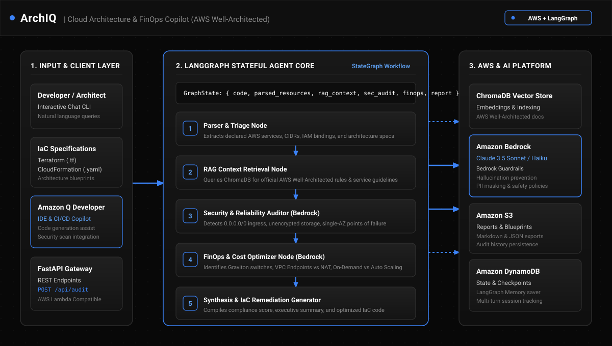

# ArchIQ

ArchIQ e um assistente para analise de arquitetura em nuvem e otimizacao de custos (FinOps) focado em AWS. O projeto analisa arquivos de infraestrutura como codigo (Terraform) ou descricoes textuais de arquitetura, cruza os componentes com as diretrizes do AWS Well-Architected Framework e gera apontamentos de seguranca, recomendacoes de economia e sugestoes de correcao no codigo.

A proposta e demonstrar na pratica a integracao entre modelos de linguagem (Amazon Bedrock), orquestracao com grafos de estado (LangGraph), busca vetorial com RAG (ChromaDB) e recursos do ecossistema AWS.



---

## Arquitetura e Componentes

O fluxo de execucao e organizado em modulos independentes:

1. **Camada de Entrada (CLI e API)**: Recebe o codigo Terraform ou descricao da arquitetura. O projeto disponibiliza tanto uma interface interativa de terminal quanto endpoints REST via FastAPI.
2. **Orquestrador de Agentes (LangGraph)**: Em vez de uma chamada direta e linear para a LLM, o fluxo e executado por uma maquina de estados:
   - Parser e Triagem: Identifica servicos AWS declarados (S3, EC2, RDS, VPC, Security Groups, IAM).
   - Recuperacao de Contexto (RAG): Busca regras e recomendacoes especificas para os servicos detectados.
   - Auditoria de Seguranca: Avalia riscos como portas abertas para a internet, falta de criptografia e pontos unicos de falha.
   - Otimizador FinOps: Avalia oportunidades de reducao de custos, como migracao para processadores Graviton e uso de VPC Endpoints para evitar custos de NAT Gateway.
   - Sintese e Remediacao: Gera o relatorio consolidado com nota de aderencia e o codigo Terraform com as correcoes aplicadas.
3. **Amazon Bedrock**: Executa o modelo de linguagem (Claude 3.5 Sonnet) para raciocinio estruturado, com suporte a Bedrock Guardrails para evitar recomendacoes inconsistentes ou inseguras.
4. **ChromaDB**: Banco vetorial local para indexacao de boas praticas baseadas no AWS Well-Architected Framework.
5. **Amazon Q**: Utilizado no processo de desenvolvimento como assistente de codificacao, geracao de testes unitarios e revisao de seguranca, alem de suportar prompts de remediacao no agente.
6. **Armazenamento AWS (S3 e DynamoDB)**:
   - S3: Armazenamento persistente de relatorios e auditorias exportadas.
   - DynamoDB: Armazenamento de checkpoints de estado das sessoes para permitir continuidade em conversas longas.

---

## Estrutura do Projeto

```text
arch_iq/
├── data/
│   └── well_architected.json    # Base de conhecimento de regras AWS para o RAG
├── docs/
│   └── architecture.svg         # Diagrama visual da arquitetura
├── src/
│   ├── config.py                # Configuracoes de ambiente e servicos AWS
│   ├── aws/
│   │   ├── bedrock.py           # Cliente Bedrock com fallback resiliente e guardrails
│   │   ├── storage.py           # Integracoes com S3 e DynamoDB
│   │   └── amazon_q.py          # Wrapper de geracao de remediacao com Amazon Q
│   ├── rag/
│   │   ├── store.py             # Gerenciamento do ChromaDB e busca vetorial
│   │   └── retriever.py         # Recuperador de diretrizes por servico
│   ├── agents/
│   │   ├── state.py             # Definicao do estado compartilhado (TypedDict)
│   │   ├── nodes.py             # Implementacao de cada no do grafo
│   │   └── graph.py             # Montagem e compilacao do StateGraph
│   ├── api/
│   │   └── app.py               # Endpoints REST (FastAPI)
│   └── cli.py                   # Interface de linha de comando
├── tests/
│   └── test_graph.py            # Testes unitarios automatizados
├── requirements.txt             # Dependencias do projeto
└── README.md
```

---

## Pre-requisitos

- Python 3.10 ou superior
- Credenciais da AWS configuradas localmente (`~/.aws/credentials` ou variaveis de ambiente `AWS_ACCESS_KEY_ID` e `AWS_SECRET_ACCESS_KEY`) com permissao de acesso ao Amazon Bedrock.

---

## Instalacao

1. Clone o repositorio e acesse a pasta:

```bash
git clone https://github.com/limajoaohs/arch_iq.git
cd arch_iq
```

2. Crie e ative um ambiente virtual:

```bash
python -m venv venv

# Windows (PowerShell):
.\venv\Scripts\Activate.ps1

# Linux / macOS:
source venv/bin/activate
```

3. Instale as dependencias:

```bash
pip install -r requirements.txt
```

---

## Como Usar

### 1. Interface de Linha de Comando (CLI)

Para auditar um arquivo Terraform diretamente:

```bash
python src/cli.py --file caminho/para/infra.tf
```

Para abrir o modo interativo no terminal:

```bash
python src/cli.py --interactive
```

### 2. Servidor de API (FastAPI)

Inicie o servidor de desenvolvimento:

```bash
uvicorn src.api.app:app --host 0.0.0.0 --port 8000 --reload
```

A documentacao interativa do Swagger ficara disponivel em `http://localhost:8000/docs`.

Exemplo de chamada via cURL:

```bash
curl -X POST http://localhost:8000/api/audit \
  -H "Content-Type: application/json" \
  -d '{
    "code_or_prompt": "resource \"aws_security_group\" \"web\" { ingress { from_port = 22 to_port = 22 protocol = \"tcp\" cidr_blocks = [\"0.0.0.0/0\"] } }"
  }'
```

---

## Execucao dos Testes

Para rodar os testes unitarios:

```bash
pytest
```

